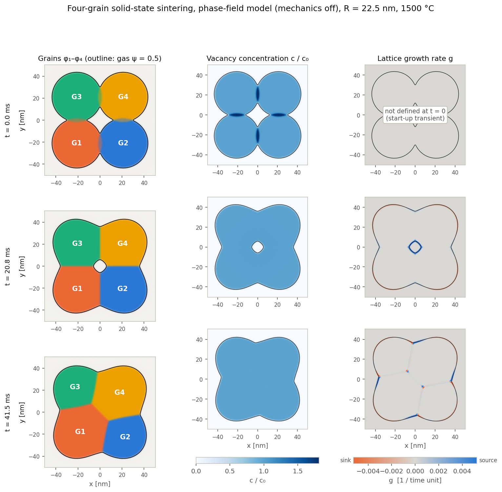

# Sintering-Multiphysics-Problem

Tools for running **phase-field sintering simulations in COMSOL Multiphysics
on a SLURM cluster**: unattended batch runs, long transient runs as
self-resubmitting restart chains, and standard sintering metrics (porosity,
neck growth, compaction) with stitched time histories and plots.

The model physics itself (free energy, transport and mechanics equations)
lives in separate research models; this repository is the automation and
analysis layer around them.

## Contents

```
comsol/
  RestartChunk.java      continue a transient solution from its last time step
  SinteringMetrics.java  add pore / neck / compaction metrics to any multi-grain model
  MphTools.java          export an .mph as Java source, or re-export a results table
hpc/
  run_comsol_job.sh      compile + run a model class; run switches via sed; license retry
  restart_chain.sh       self-resubmitting restart chain with a plateau stop criterion
post/
  comsol_csv.py          read/write COMSOL table exports
  stitch_restarts.py     merge chunks, drop duplicated restart points, decide when to stop
  plot_timeseries_svg.py multi-panel time-series SVG (standard library only)
  neck_exponent.py       neck-growth exponent fit to validate calibration choices
docs/
  comsol-batch-pitfalls.md   problems hit when running COMSOL headless, and fixes
  timescale-calibration.md   making sintering runs affordable without losing physics
```

## Gallery

[Four-grain solid-state sintering](gallery/four-grain-sintering/): phase-field
snapshots (grains, vacancy concentration, lattice growth) and pore / neck /
compaction histories from a long checkpointed run.



## Sintering metrics

For grains φ₁…φₙ and gas ψ = 1 − Σφᵢ, `SinteringMetrics.add(...)` defines:

| Metric | Definition |
|---|---|
| pore area, porosity | ∫ψ dA over a unit cell whose corners are the grain centres |
| pore equivalent radius | √(A_pore/π) |
| neck width | solid length ∫Σφᵢ ds along each contact plane (line integral) |
| neck width, co-area check | ∫ 3φᵢφⱼ(\|∇φᵢ\|+\|∇φⱼ\|) dA |
| compaction | 1 − d/d₀ with d the distance between φ-weighted grain centroids |
| mass check | ∫Σφᵢ dA |
| free-surface length | ∫ 6ψ(1−ψ)\|∇ψ\| dA |

## Typical workflow

```bash
# 1. run a model class (switches are rewritten into the source before compiling)
JAVA=MyModel.java SET="SOLVE=true;TLIST=range(0,1,100)" \
  sbatch -p <partition> -A <account> hpc/run_comsol_job.sh

# 2. continue it as a restart chain until neck ratio and surface length plateau
mkdir -p chain/logs
TOOLS=$PWD PREV_MPH=$PWD/runs/MyModel_123/MyModel_solved.mph \
INIT_CSV=$PWD/runs/MyModel_123/metrics.csv SBATCH_ARGS="-p <partition> -A <account>" \
  sbatch -p <partition> -A <account> hpc/restart_chain.sh

# 3. plot the stitched history and check the neck-growth exponent
python3 post/plot_timeseries_svg.py chain/combined/metrics.csv history.svg \
  pore_area,porosity neck_ratio center_dist
python3 post/neck_exponent.py chain/combined/metrics.csv
```

Requirements: COMSOL Multiphysics 6.x with the Java API (`comsol compile`,
`comsol batch`), SLURM, Python 3 (standard library only).

## License
MIT
