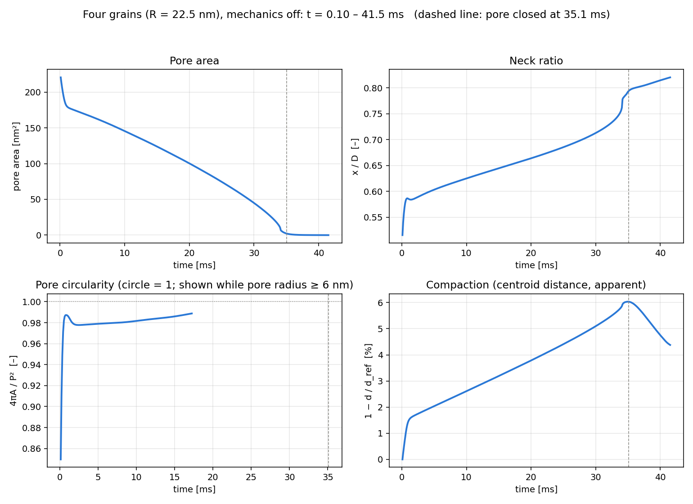

# Four-grain solid-state sintering (phase-field, mechanics off)

Four equal grains (radius 22.5 nm) in a 2 × 2 arrangement sintering at
1500 °C, simulated with a multi-order-parameter phase-field model coupled
to vacancy diffusion in COMSOL Multiphysics. The mechanics is switched off,
so the grains cannot translate. The run is a long, checkpointed batch job
on a SLURM cluster (about 2000 model time units so far, still running).

## Field snapshots

Rows show the initial state, the state when the central pore is about
half filled (20.8 ms) and the state after pore closure (41.5 ms).

- **Grains (left).** Each grain carries its own order parameter. The
  initial point contacts become wide necks, and the central pore first
  rounds off and then closes. Later the grain boundaries migrate and one
  grain grows at the expense of its neighbour (grain growth after
  densification).
- **Vacancy concentration (middle).** Vacancies are in equilibrium inside
  the grains and drop to zero across the free surface. At t = 0 they are
  enriched where the initial grains overlap; this relaxes within the first
  0.1 ms.
- **Lattice growth (right).** This shows where lattice sites are created
  (source) and removed (sink). Activity is concentrated at the moving free
  surfaces and at the pore while it closes.

## Sintering metrics

- **Pore area.** The central pore fills steadily and closes at about 35 ms.
- **Neck ratio x/D.** This is the neck width over the particle diameter.
  It rises from about 0.52 to 0.82, with a jump when the pore closes.
- **Pore circularity 4πA/P².** The pore becomes almost circular (about
  0.98) within the first millisecond and stays round while it shrinks. The
  curve is shown only while the pore is at least four interface widths
  across; below that, a diffuse-interface estimate is not meaningful.
- **Compaction.** This is calculated from the distance between grain
  centroids. With the mechanics off, it is *apparent* compaction: material
  is redistributed toward the necks and the pore, and the grains do not
  move together. After pore closure, grain-boundary migration moves the
  centroids again.

The first 0.1 ms are excluded from the metrics because the grains start
slightly overlapping and the diffuse profiles need a short time to relax.

## How the run was managed

- **Segmented solve.** The transient solve runs in segments, with a full
  checkpoint after each one, so a cancelled or preempted job loses at most
  one segment. The run continues from the last checkpoint.
- **Stop criterion.** The stop check is based on saturation of the neck
  ratio and free-surface length, not on pore area alone (see
  `docs/timescale-calibration.md` and `post/stitch_restarts.py`).
- **Post-processing.** Segment outputs are stitched into one time history,
  and metrics are converted from model units to physical units.
